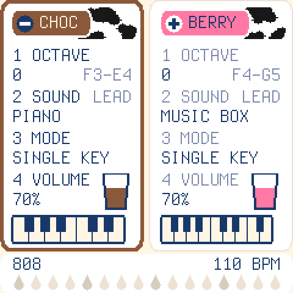

# SPLITMILK

**Two instruments on one keyboard, for the M-VAVE FM-1.**

SPLITMILK splits the FM-1's keyboard in two. The lower keys play one instrument, called **CHOC**, and the upper keys
play another, called **BERRY**, at the same time. Play chords with your left hand and a melody with your right, or a
bass line under a lead. A drum machine and a pad sequencer complete the package.

## Highlights

- **Two instruments at once**, each with its own sound, octave, volume and playing mode. The split point can be moved
  to any key.
- **24 synth sounds**: leads, pads and basses, from piano and strings to acid bass.
- **Playing modes**: single notes, one-key chords (major, minor, 7th), octaves, or an arpeggiator.
- **Latch**: hold a chord or an arpeggio, press REC, and let go: it keeps playing.
- **Effects for each instrument**: reverb, delay, distortion, chorus and phaser.
- **A wave editor** to shape any sound: oscillators, filter, envelope and LFO.
- **A drum machine** with 8 kits, including real samples of a Linn LM-1 and a Korg Mini Pops.
- **Paddock**, a pad sequencer: up to 4 bars of chords that play along with the drums.
- **4 save slots**, and your current setup is kept when you switch off.

## Quick start

| To | Do this |
| --- | --- |
| Play | The lower keys play CHOC; the upper keys (always lit) play BERRY |
| Choose which instrument the knobs change | Press **OCT-** for CHOC or **OCT+** for BERRY (it lights up) |
| Change its octave, sound, mode, volume | Turn **KNOB 1, 2, 3, 4** |
| Move the split | Turn **SELECT** |
| Change key (transpose) | Turn **PRESETS** |
| Change the tempo | Turn **ALGORITHM** |
| Keep the notes you hold playing | Press **REC** while holding them; press **REC** again to stop |
| Turn an effect on or off | Tap **FX** (reverb), **SEL** (delay), **ENV** (distortion), **LFO** (chorus) or **EDIT** (phaser) |
| Adjust an effect | Hold its button for half a second |
| Arpeggiator settings | **ARP** |
| Edit the sound | **GLO** |
| Drums and Paddock | **SEQ**, then **PLAY** to start and stop |
| Save or load | **SAVE** |
| Go back to the main screen | **HOME** |
| Start over | Hold **REC** for a second on the main screen |

Everything else is in the **[user guide](docs/USER_GUIDE.md)**.

## Install

> SPLITMILK is experimental firmware. **Back up your FM-1 before installing**, so you can always go back. Installing
> firmware is at your own risk. SPLITMILK is not made or endorsed by M-VAVE.

1. Download `splitmilk.fwsc`. It's attached to each **[release](../../releases)** when there is one; the newest test
   build is always under **[Actions](../../actions)**: open the latest successful run and download the
   `splitmilk-fwsc` artifact (a zip containing the `.fwsc`).
2. Install it with **[M-Flasher](https://github.com/jvitkauskas/m-flasher)** (Windows, macOS, Linux): connect the
   FM-1, press **DOWNLOAD MODE**, **back up the whole flash**, then choose **Install firmware (.fwsc)**.

   Or, from a terminal, over USB-MIDI: `pip install mido python-rtmidi`, then
   `python tools/fm1_install.py splitmilk.fwsc`.

Once installed, the FM-1 identifies itself as `FM-1_986`.

**Going back to the original firmware**: restore your M-Flasher backup, or install M-VAVE's official `FM-1.fwsc`.
SPLITMILK stores its settings and save slots where the original firmware keeps its presets, so without a backup you
may need to use *System → Reset Patches* on the original firmware afterwards.

**If something goes wrong**: hold **OCT-** while switching the FM-1 on. It starts in USB rescue mode, and you can
install again. Never switch off or unplug while an install is writing.

## Credits

SPLITMILK is by **MammothCheese**. It grew out of [QUARTET](https://github.com/MammothCheese/quartet), which gave it
its synth engine and drum kits, and it runs on **[Dinghy](https://github.com/zvenson/dinghy)** by zvenson. Dinghy
carries the platform of **[Felucca](https://github.com/hugelton/Felucca)** by Leo Kuroshita (Hügelton Instruments),
with the work of **[SLOOP](https://github.com/isod89/sloop-fm1)** (isod89), OberVave (zvenson), the SMK-37 layer of
M. Geisler (genkigenki) and the loader idea of [Skiff](https://github.com/illuminus5/skiff) (illuminus5). Thank you
all.

The sampled drum kits use:

- **LM-1**: "Linn LM1 (LM-1) Drum Set" by [rossf](https://freesound.org/people/rossf/packs/4919/), under Sampling+ 1.0
  ([details](assets/samples/LM1-ATTRIBUTION.txt)).
- **MINI POPS**: Drumkito's
  [Korg Mini Pops Sample Pack](https://www.drumkito.com/sample-packs/korg-mini-pops-sample-pack/), recorded from a
  Korg Mini Pops 120 ([details](assets/samples/MINIPOPS-SOURCE.txt)).

## License

SPLITMILK is free software under the **GPL-3.0-only** licence, like everything it is built on: you may use, change and
share it, and anyone who receives a firmware built from it is entitled to its source code. The drum samples are not
covered by the GPL and keep their own terms. Who made what, and every third-party part:
**[LICENSING.md](LICENSING.md)**.

You can also try SPLITMILK in the browser, no flashing needed, in the free community [FM-1 Emulator](https://fm1-emulator.atst.tools/).
